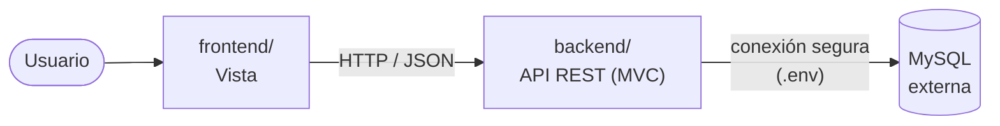

# AXON Stack Flow

Sistema web para **gestión de usuarios con autenticación segura** (verificación por correo en dos pasos) y **monitoreo de la API** (registro de peticiones, métricas y endpoints).

- **Backend:** API REST en Node.js + Express, patrón **MVC por capas** (Rutas → Controladores → Servicios → Modelos).
- **Frontend (Vista):** SPA en HTML, CSS y JavaScript (módulos ES), sin frameworks.
- **Base de datos:** MySQL 8 **externa**. No está dentro del proyecto; el backend se conecta por red y el frontend solo habla con la API.



## Estructura del proyecto

```
axon-stack-flow/
│
├── backend/                         API REST (Node.js + Express)
│   ├── src/
│   │   ├── server.js                Arranque: valida .env, conecta BD, inicia servidor
│   │   ├── app.js                   Configura Express: seguridad, rutas y errores
│   │   ├── config/                  Configuración
│   │   │   ├── environment.js         Variables de entorno (único lugar que lee .env)
│   │   │   └── database.js            Conexión a la BD externa
│   │   ├── constants/               Valores fijos: roles, parámetros de seguridad
│   │   ├── routes/                  RUTAS: URL + método + middlewares
│   │   │   ├── index.js               Punto de entrada /api (empieza aquí)
│   │   │   ├── auth.routes.js
│   │   │   ├── user.routes.js
│   │   │   ├── endpoint.routes.js
│   │   │   └── metric.routes.js
│   │   ├── controllers/             CONTROLADORES: reciben la petición y responden
│   │   ├── services/                SERVICIOS: reglas de negocio
│   │   ├── models/                  MODELOS: entidades + SQL (una tabla por modelo)
│   │   ├── dtos/                    DTOs: validan la entrada y dan forma a la salida
│   │   ├── middlewares/             Autenticación, roles, validación, límite de intentos, logs, errores
│   │   └── utils/                   Utilidades (HttpError, validadores)
│   ├── scripts/create-admin.js      Crea el primer administrador
│   ├── tests/
│   │   ├── unit/                    Pruebas sin base de datos
│   │   └── integration/             Pruebas contra la API en ejecución
│   ├── .env.example                 Plantilla de configuración (el .env real no se sube)
│   └── package.json
│
├── frontend/                        VISTA (interfaz web)
│   ├── index.html                   Página única
│   ├── server.js                    Servidor local de desarrollo
│   ├── assets/                      css/ e img/
│   └── src/
│       ├── main.js                  Punto de entrada
│       ├── config/                  URL de la API y claves de almacenamiento
│       ├── router/                  Rutas #/... → vista
│       ├── views/                   VISTAS por módulo: auth, dashboard, users, endpoints, profile
│       ├── components/              Piezas reutilizables: layout, modal, gráfica, encabezado
│       ├── services/                Llamadas a la API (un servicio por recurso)
│       └── utils/                   DOM, iconos, notificaciones, CSV
│
├── docs/                            DOCUMENTACIÓN (ver docs/README.md)
│   ├── 01-requerimientos/           RF y RNF
│   ├── 02-casos-de-uso/
│   ├── 03-endpoints/
│   ├── 04-base-de-datos/            Modelo E-R, diccionario y script para el servidor externo
│   ├── 05-diagrama-clases/
│   ├── 06-diagrama-secuencia/
│   ├── 07-diagrama-actividades/
│   ├── 08-trazabilidad/             Matriz RF → CU → endpoint → tabla → clase → vista
│   └── guias/                       Instalación y uso
│
├── .gitignore
├── package.json                     Atajos para iniciar backend y frontend
└── README.md
```

### Convención de nombres

| Capa | Carpeta | Archivo | Ejemplo |
|---|---|---|---|
| Ruta | `routes/` | `<recurso>.routes.js` | `user.routes.js` |
| Controlador | `controllers/` | `<recurso>.controller.js` | `user.controller.js` |
| Servicio | `services/` | `<recurso>.service.js` | `user.service.js` |
| Modelo | `models/` | `<entidad>.model.js` | `user.model.js` |
| DTO | `dtos/` | `<recurso>.dto.js` | `user.dto.js` |
| Middleware | `middlewares/` | `<función>.middleware.js` | `auth.middleware.js` |
| Vista | `frontend/src/views/<módulo>/` | `<pantalla>.view.js` | `users/users.view.js` |
| Componente | `frontend/src/components/` | `<nombre>.component.js` | `modal.component.js` |

Cada archivo empieza con un comentario que dice qué es y qué requerimiento (RF) cumple.

## Recorrido de una petición

Ejemplo: el administrador crea un usuario.

1. **Vista** `frontend/src/views/users/users.view.js` → llama a `services/user.service.js` → `POST /api/users`
2. **Ruta** `backend/src/routes/user.routes.js` → `authenticate` → `authorize(admin)` → `validateBody(CreateUserDto)`
3. **Controlador** `controllers/user.controller.js` → `create()`
4. **Servicio** `services/user.service.js` → verifica correo único y cifra la contraseña
5. **Modelo** `models/user.model.js` → `INSERT INTO users` en la BD externa
6. La respuesta vuelve como `UserResponseDto` (sin contraseña) y la vista actualiza la tabla.

## Inicio rápido

```bash
# 1. Backend
cd backend
npm install
cp .env.example .env        # en Windows: copy .env.example .env  → completar datos de la BD externa
npm run create-tables       # crea las tablas (una sola vez)
npm run create-admin -- "Nombre" admin@correo.com "Contraseña1"
npm start                   # http://localhost:4000/api

# 2. Frontend (otra terminal, desde la raíz)
npm run frontend            # http://localhost:5500
```

Guía completa: [docs/guias/instalacion.md](docs/guias/instalacion.md)

## Documentación

Toda la documentación de análisis y diseño está en [`docs/`](docs/README.md): requerimientos, casos de uso, endpoints, base de datos, diagramas de clases, secuencia y actividades, y la matriz de trazabilidad.
