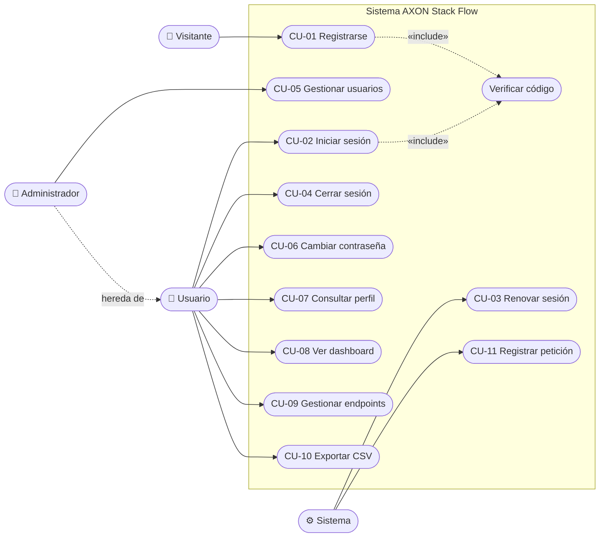

# 02 · Casos de Uso

Derivados de los [requerimientos funcionales](../01-requerimientos/requerimientos-funcionales.md). Cada caso de uso indica los RF que cubre y los endpoints que lo implementan.

## Diagrama de casos de uso

> El Administrador hereda todos los casos de uso del Usuario y además gestiona usuarios y endpoints.

## Resumen

| Caso de uso | Actor principal | RF | Endpoints |
|---|---|---|---|
| CU-01 Registrarse | Visitante | RF-01, RF-02, RF-04 | `POST /auth/register`, `POST /auth/register/verify`, `POST /auth/register/resend-code` |
| CU-02 Iniciar sesión | Usuario | RF-03, RF-04 | `POST /auth/login`, `POST /auth/login/verify`, `POST /auth/login/resend-code` |
| CU-03 Renovar sesión | Sistema | RF-05 | `POST /auth/refresh-token` |
| CU-04 Cerrar sesión | Usuario | RF-16 | — (se eliminan los tokens del navegador) |
| CU-05 Gestionar usuarios | Administrador | RF-06, RF-07, RF-08, RF-10 | `GET/POST /users`, `GET/PUT/DELETE /users/:id` |
| CU-06 Cambiar contraseña | Usuario | RF-09 | `PATCH /users/:id/password` |
| CU-07 Consultar perfil | Usuario | RF-17 | — (datos de la sesión) |
| CU-08 Ver dashboard | Usuario | RF-11 | `GET /metrics/dashboard` |
| CU-09 Gestionar endpoints | Usuario (consulta) / Administrador | RF-12, RF-13 | `GET/POST /endpoints`, `DELETE /endpoints/:id` |
| CU-10 Exportar CSV | Usuario | RF-15 | — (se genera en el navegador) |
| CU-11 Registrar petición | Sistema | RF-14 | Todas (middleware) |

---

## Especificación de los casos de uso principales

### CU-01 Registrarse

| Campo | Detalle |
|---|---|
| Actor | Visitante |
| Precondición | El correo no está registrado. |
| Flujo principal | 1. El visitante abre **Registrarse** e ingresa nombre, correo y contraseña. 2. El sistema valida los datos, crea la cuenta sin verificar y envía un código de 6 dígitos. 3. El visitante ingresa el código. 4. El sistema marca el correo como verificado y lo envía a **Iniciar sesión**. |
| Flujos alternos | 2a. Correo ya registrado → mensaje "El correo ya está registrado". 3a. Código incorrecto o vencido → mensaje de error; puede **reenviar código** (RF-04). |
| Postcondición | Cuenta activa con rol `user` y correo verificado. |

### CU-02 Iniciar sesión (dos pasos)

| Campo | Detalle |
|---|---|
| Actor | Usuario / Administrador |
| Precondición | Cuenta activa y correo verificado. |
| Flujo principal | 1. Ingresa correo y contraseña. 2. El sistema valida las credenciales y envía un código al correo. 3. Ingresa el código. 4. El sistema entrega token de acceso y refresh token y muestra el **Dashboard**. |
| Flujos alternos | 2a. Credenciales incorrectas → 401. 2b. Cuenta desactivada o correo sin verificar → 403. 2c. Más de 5 intentos fallidos en 15 min → 429. 3a. Código incorrecto, vencido o con 5 intentos → error; puede reenviar. |
| Postcondición | Sesión iniciada. |

### CU-05 Gestionar usuarios

| Campo | Detalle |
|---|---|
| Actor | Administrador |
| Precondición | Sesión iniciada con rol `admin`. |
| Flujo principal | 1. Abre **Usuarios** y ve la lista. 2. Puede **crear** (nombre, correo, rol, contraseña), **editar** (nombre, correo, rol y opcionalmente contraseña) o **eliminar** un usuario. 3. El sistema valida, guarda y actualiza la lista. |
| Flujos alternos | Correo repetido → 409. Eliminar a sí mismo o a un usuario demo → 400. Usuario sin rol admin → no ve la opción (403 en la API). |
| Postcondición | Cambios guardados. La eliminación es lógica (rol `inactive`). |

### CU-08 Ver dashboard

| Campo | Detalle |
|---|---|
| Actor | Usuario / Administrador |
| Precondición | Sesión iniciada. |
| Flujo principal | 1. Abre **Dashboard**. 2. El sistema calcula totales de usuarios y endpoints, peticiones de las últimas 24 h, latencia promedio, distribución por código y método, y las 10 últimas peticiones. 3. Puede exportar la actividad a CSV (CU-10). |
| Postcondición | — |

### CU-09 Gestionar endpoints

| Campo | Detalle |
|---|---|
| Actor | Usuario (solo consulta) / Administrador |
| Flujo principal | 1. Abre **Endpoints** y ve la lista. 2. (Admin) Registra un endpoint con nombre, ruta (empieza con `/`), método HTTP y descripción, o elimina uno. |
| Flujos alternos | Datos inválidos → 400. Endpoint inexistente → 404. |
