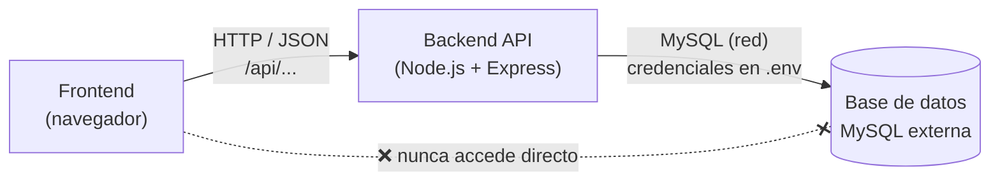
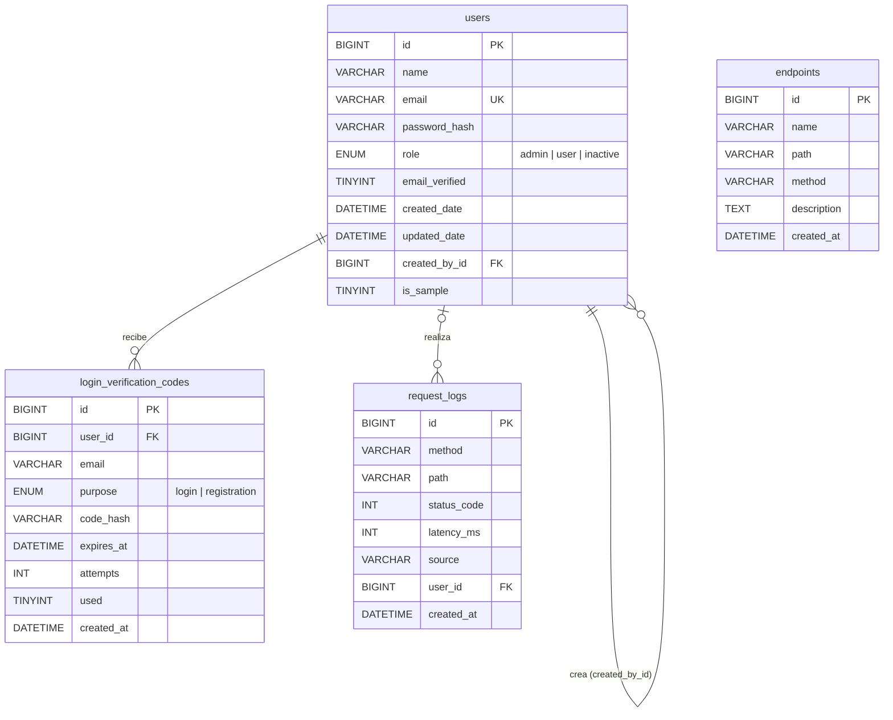

# 04 · Base de Datos

## La base de datos está fuera del sistema

Por seguridad, **la base de datos no forma parte de este proyecto**. Vive en un servidor MySQL 8 externo y la aplicación solo se conecta a ella a través de la API del backend:



- El frontend **nunca** se conecta a la base de datos: solo llama a la API.
- El backend se conecta con las variables `DB_HOST`, `DB_PORT`, `DB_USER`, `DB_PASSWORD`, `DB_NAME` (y `DB_SSL`) del archivo `backend/.env`, que **no se sube** al repositorio.
- Solo los **modelos** (`backend/src/models/`) ejecutan SQL. Todas las consultas usan parámetros (`?`) para evitar inyección SQL.
- El administrador de la base de datos crea las tablas una única vez con [`script-creacion.sql`](script-creacion.sql).

## Diagrama Entidad-Relación



## Diccionario de datos

### `users` — usuarios del sistema · RF-01, RF-06 a RF-10 · Modelo: `user.model.js`

| Campo | Tipo | Nulo | Descripción |
|---|---|---|---|
| id | BIGINT UNSIGNED | No | Llave primaria, autoincremental |
| name | VARCHAR(120) | No | Nombre completo |
| email | VARCHAR(190) | No | Correo, único |
| password_hash | VARCHAR(255) | No | Contraseña cifrada con bcrypt (RNF-01) |
| role | ENUM | No | `admin`, `user` o `inactive` (eliminado lógicamente) |
| email_verified | TINYINT(1) | No | 1 si el correo fue verificado (RF-02) |
| created_date / updated_date | DATETIME | No | Fechas de creación y última modificación |
| created_by_id | BIGINT UNSIGNED | Sí | FK a `users.id`: administrador que lo creó |
| is_sample | TINYINT(1) | No | 1 = usuario demo protegido, no se puede eliminar |

### `login_verification_codes` — códigos enviados por correo · RF-02, RF-03, RF-04 · Modelo: `verification-code.model.js`

| Campo | Tipo | Nulo | Descripción |
|---|---|---|---|
| id | BIGINT UNSIGNED | No | Llave primaria |
| user_id | BIGINT UNSIGNED | Sí | FK a `users.id` (se borra en cascada) |
| email | VARCHAR(190) | No | Correo al que se envió |
| purpose | ENUM | No | `login` o `registration` |
| code_hash | VARCHAR(255) | No | Código cifrado con bcrypt |
| expires_at | DATETIME | No | Vence 5 minutos después de creado (RNF-04) |
| attempts | INT | No | Intentos realizados (máximo 5) |
| used | TINYINT(1) | No | 1 si ya se usó o fue invalidado |

### `endpoints` — endpoints monitoreados · RF-12, RF-13 · Modelo: `endpoint.model.js`

| Campo | Tipo | Nulo | Descripción |
|---|---|---|---|
| id | BIGINT UNSIGNED | No | Llave primaria |
| name | VARCHAR(120) | No | Nombre descriptivo |
| path | VARCHAR(255) | No | Ruta, p. ej. `/api/users` |
| method | VARCHAR(10) | No | GET, POST, PUT, PATCH o DELETE |
| description | TEXT | Sí | Descripción opcional |

### `request_logs` — registro de peticiones · RF-11, RF-14 · Modelo: `request-log.model.js`

| Campo | Tipo | Nulo | Descripción |
|---|---|---|---|
| id | BIGINT UNSIGNED | No | Llave primaria |
| method / path | VARCHAR | No | Método y ruta solicitados |
| status_code | INT | No | Código HTTP de la respuesta |
| latency_ms | INT | No | Tiempo de respuesta en milisegundos |
| source | VARCHAR(64) | Sí | IP de origen |
| user_id | BIGINT UNSIGNED | Sí | FK a `users.id` si había sesión |

## Primer administrador

Con las tablas creadas, el primer administrador se crea desde el backend (la contraseña no queda guardada en el código):

```bash
cd backend
npm run create-admin -- "Nombre Apellido" admin@correo.com "ContraseñaSegura1"
```
