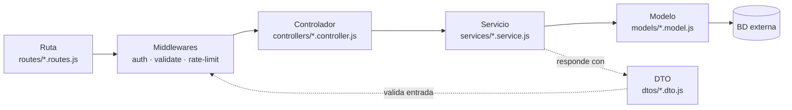
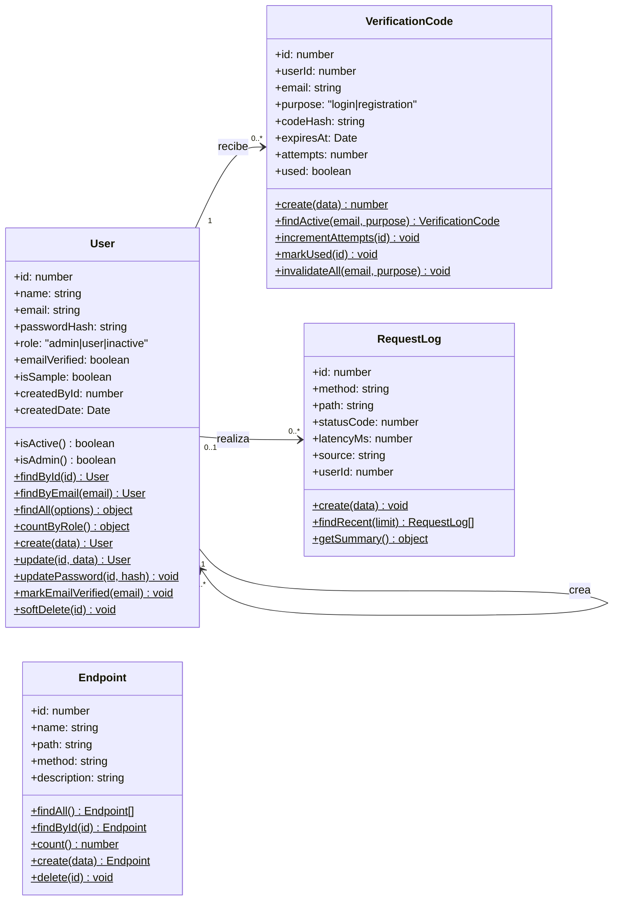
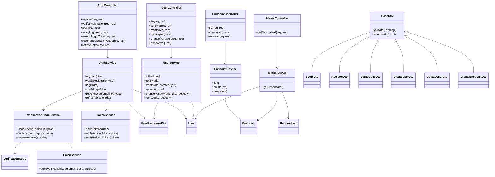

# 05 · Diagrama de Clases

El backend sigue el patrón **MVC por capas**. Cada endpoint de la [API](../03-endpoints/endpoints-api.md) recorre las mismas capas:

| Capa | Responsabilidad | Ejemplo |
|---|---|---|
| **Vista** | Interfaz que ve el usuario (frontend) | `frontend/src/views/users/users.view.js` |
| **Ruta** | URL + método HTTP + middlewares | `routes/user.routes.js` |
| **Controlador** | Lee la petición y devuelve la respuesta HTTP | `controllers/user.controller.js` |
| **Servicio** | Reglas de negocio | `services/user.service.js` |
| **Modelo** | Entidad + consultas SQL a su tabla | `models/user.model.js` |
| **DTO** | Valida la entrada y da forma a la salida | `dtos/user.dto.js` |

## Modelos (entidades)

Cada modelo corresponde a una tabla de la [base de datos](../04-base-de-datos/modelo-datos.md).

## Controladores, servicios y DTOs

> Nota: en el código los controladores y servicios son módulos de funciones (CommonJS). Se representan como clases porque cada archivo agrupa las operaciones de un mismo recurso.
