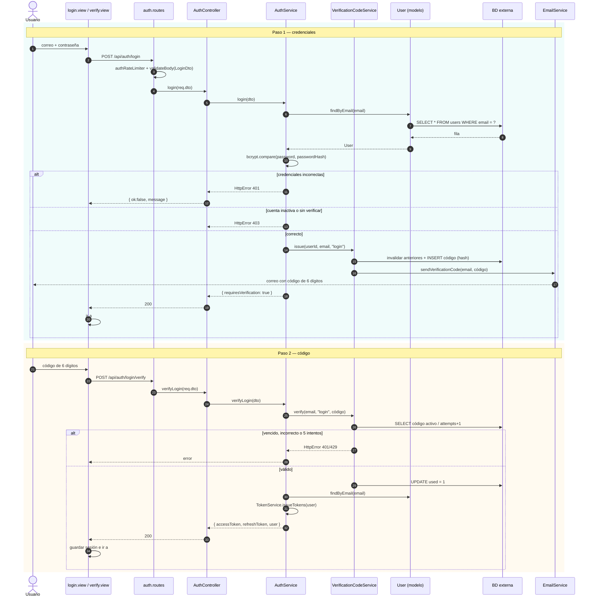
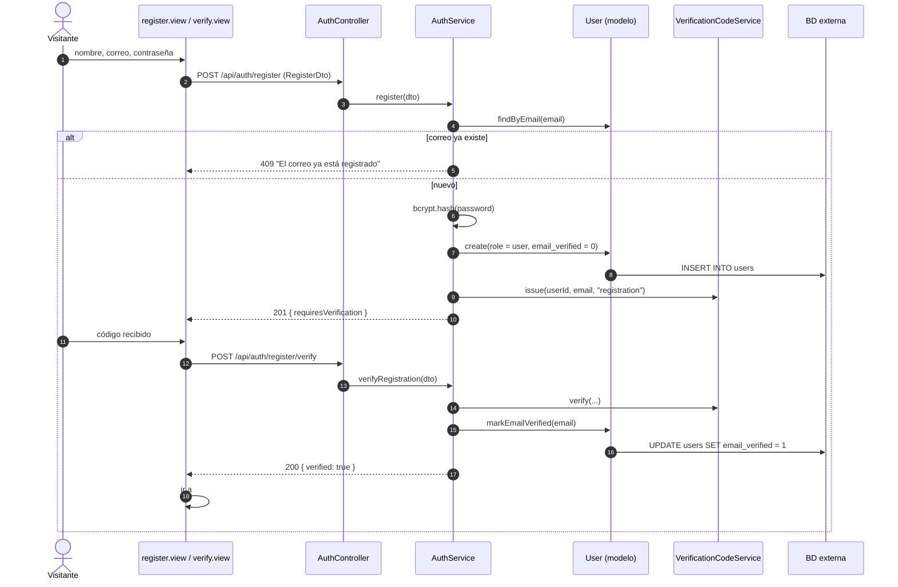
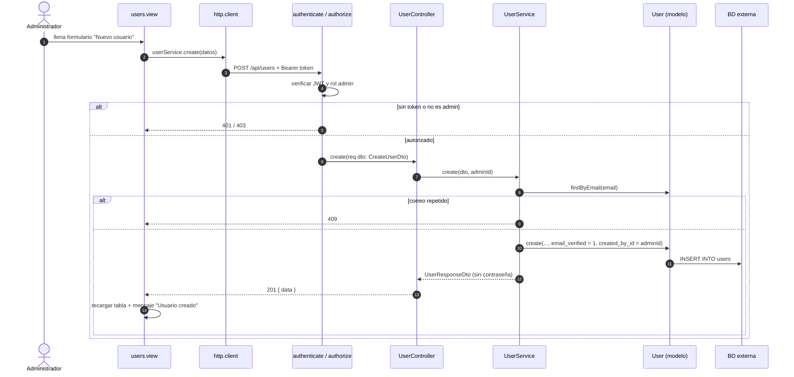
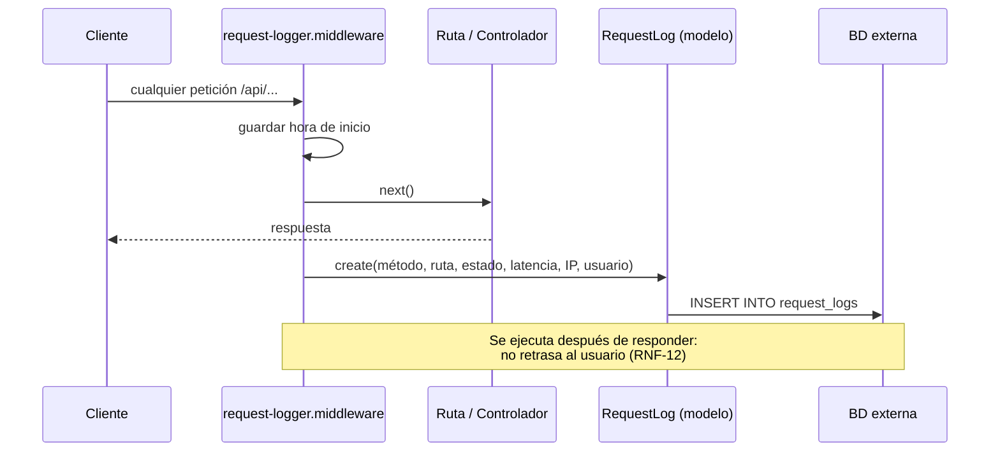

# 06 · Diagramas de Secuencia

Muestran cómo colaboran en el tiempo las clases del [diagrama de clases](../05-diagrama-clases/diagrama-clases.md) para atender un caso de uso.

## SD-01 Iniciar sesión en dos pasos (CU-02 · RF-03)

## SD-02 Registrarse y verificar correo (CU-01 · RF-01, RF-02)

## SD-03 Crear usuario como administrador (CU-05 · RF-07)

## SD-04 Registro automático de peticiones (CU-11 · RF-14)

