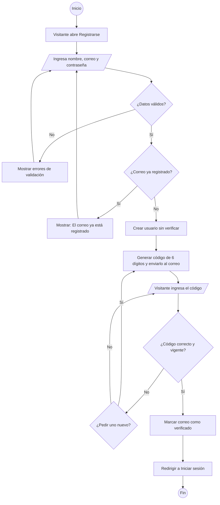
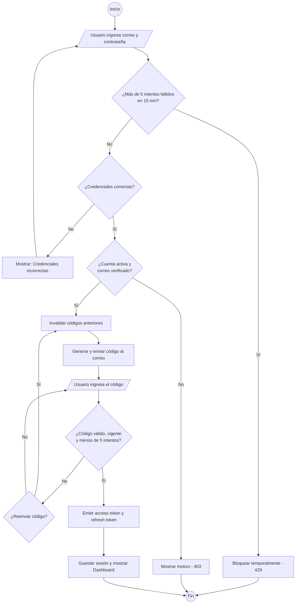
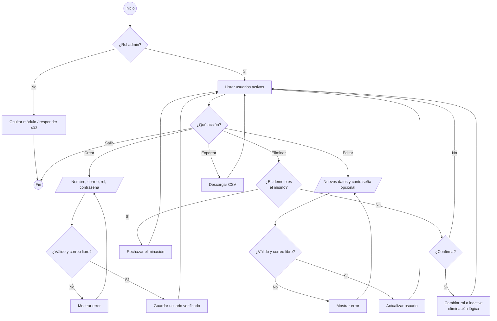
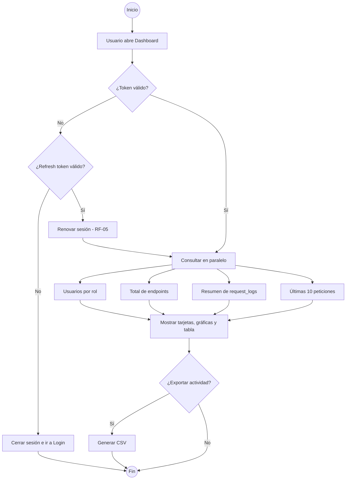

# 07 · Diagramas de Actividades

Describen el flujo de trabajo de cada [requerimiento funcional](../01-requerimientos/requerimientos-funcionales.md) desde el punto de vista del usuario y del sistema.

## AD-01 Registro y verificación de correo (RF-01, RF-02, RF-04)

## AD-02 Inicio de sesión en dos pasos (RF-03, RF-04)

## AD-03 Gestión de usuarios por el administrador (RF-06, RF-07, RF-08, RF-10)

## AD-04 Consulta del dashboard (RF-11, RF-14, RF-15)

