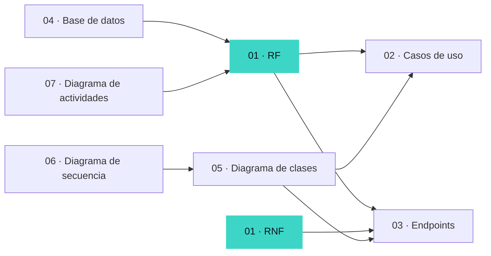

# Documentación — AXON Stack Flow

La documentación sigue el orden en que se diseñó el sistema. Todo nace de los **requerimientos** y cada artefacto se conecta con ellos:

| # | Documento | Qué contiene | Se relaciona con |
|---|---|---|---|
| 01 | [Requerimientos funcionales](01-requerimientos/requerimientos-funcionales.md) | RF-01 a RF-17 | Punto de partida |
| 01 | [Requerimientos no funcionales](01-requerimientos/requerimientos-no-funcionales.md) | RNF-01 a RNF-15 y dónde se cumplen | Endpoints, código |
| 02 | [Casos de uso](02-casos-de-uso/casos-de-uso.md) | Diagrama + especificación CU-01 a CU-11 | RF |
| 03 | [Endpoints de la API](03-endpoints/endpoints-api.md) | Cada ruta con su RF, rol, entrada y salida | RF, RNF |
| 04 | [Base de datos](04-base-de-datos/modelo-datos.md) | BD externa, diagrama E-R, diccionario de datos, [script](04-base-de-datos/script-creacion.sql) | RF |
| 05 | [Diagrama de clases](05-diagrama-clases/diagrama-clases.md) | Capas MVC, modelos, controladores, servicios, DTOs | Endpoints, casos de uso |
| 06 | [Diagramas de secuencia](06-diagrama-secuencia/diagrama-secuencia.md) | Login, registro, crear usuario, registro de peticiones | Diagrama de clases |
| 07 | [Diagramas de actividades](07-diagrama-actividades/diagrama-actividades.md) | Flujos de registro, login, gestión de usuarios, dashboard | RF |
| 08 | [Matriz de trazabilidad](08-trazabilidad/matriz-trazabilidad.md) | Cada RF con su CU, endpoint, tabla, clases, diagramas y vista | Todo |

**Guías:** [Instalación](guias/instalacion.md) · [Uso del sistema](guias/guia-uso.md)

> Los diagramas están escritos en Mermaid: GitHub los muestra como imágenes automáticamente. En VS Code se ven con la extensión *Markdown Preview Mermaid Support*.
